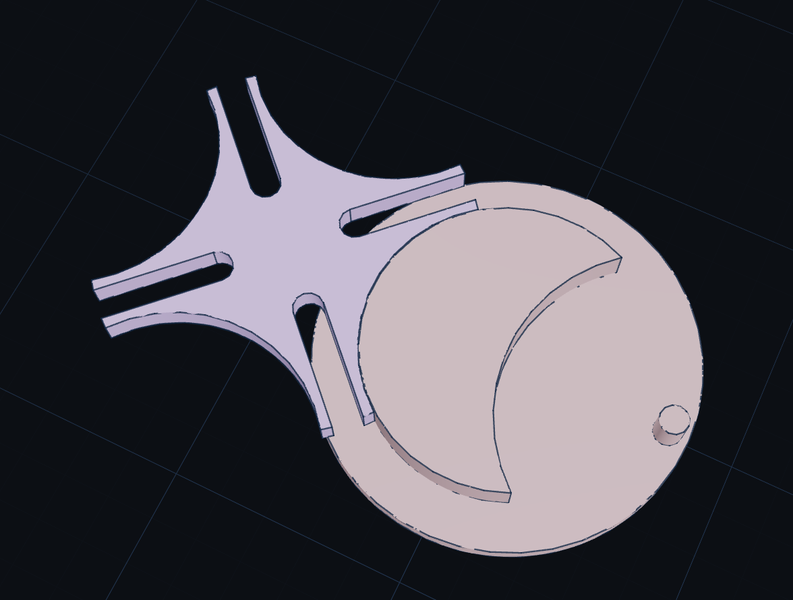
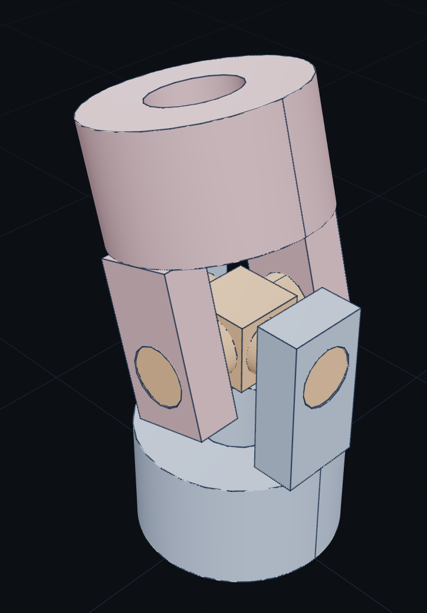
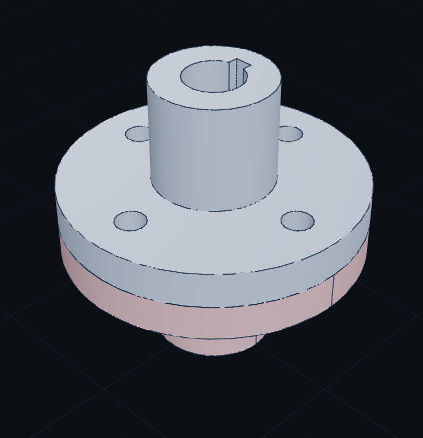
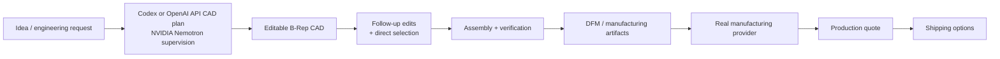
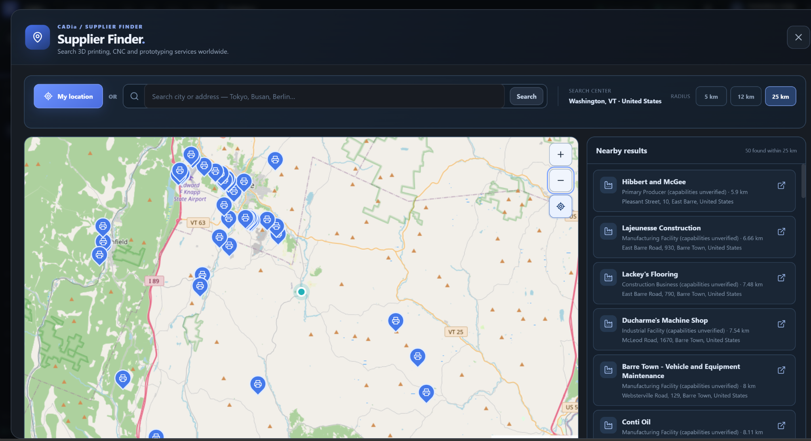

# CADia — Design Anywhere. Describe It. Edit It. Manufacture It.

> **From a sentence to verified, editable mechanical CAD — and a live manufacturing quote — without leaving the browser. NVIDIA Nemotron verifies engineering requirements in Codex/OpenAI API CAD workflows; CADia executes verified, editable B-Rep geometry.**

**Live app:** https://app.cadia.co.kr  
**Hackathon track:** Best Apps and Agents  
**AI:** NVIDIA Nemotron 3 Ultra via Nebius Token Factory  
**CAD kernel:** Open CASCADE / CadQuery  
**Judge guide:** [`docs/JUDGE_GUIDE.md`](docs/JUDGE_GUIDE.md) · **3-minute pitch plan:** [`docs/DEMO_3MIN.md`](docs/DEMO_3MIN.md) · **Saved CAD evidence:** [`evidence/`](evidence/)  

---


### Real CAD results from the current build

<table>
<tr>
<td align="center"><br><b>Geneva mechanism</b></td>
<td align="center"><br><b>Universal-joint assembly</b></td>
<td align="center"><br><b>Flange-coupling assembly</b></td>
</tr>
</table>

These are saved outputs from CADia, not concept renders. Their prompts and export artifacts are included under [`evidence/`](evidence/).

## What is CADia?

CADia turns the browser into an AI-native mechanical CAD workspace. A user can open CADia from anywhere, describe a part in natural language, receive a **real editable B-Rep CAD model**, keep modifying that same model with follow-up requests or direct face/edge selection, build assemblies, validate the result, and continue into manufacturing.

The product is designed around one continuous workflow:

```text
Open a browser anywhere
        ↓
Describe the mechanical part you need
        ↓
Codex / OpenAI API plans CAD with Nemotron supervision
        ↓
CADia builds verified editable B-Rep CAD
        ↓
Keep talking to modify the same model
        ↓
Select exact faces / edges / parts when needed
        ↓
Create assemblies and verify geometry
        ↓
DFM + STEP / STL / 3MF / G-code
        ↓
Connect the current model to a real manufacturing provider
        ↓
Live production quote + destination shipping workflow
        ↓
Physical production path
```

That is the core difference: **CADia is not only text-to-3D. It is a browser-to-manufacturing product.**

> The public hackathon deployment keeps final payment/order creation disabled to prevent accidental purchases, while the live manufacturing material, production-quote, quantity, and shipping workflow is implemented.

---

## The product in 20 seconds

| Traditional workflow | CADia |
| --- | --- |
| Install a desktop CAD package | Open a browser |
| Learn many modeling commands | Describe the design in normal language |
| Rebuild geometry manually after changes | Continue editing the same CAD model conversationally |
| Hunt for the exact feature to modify | Select a face, edge, object, or feature directly |
| Move between separate CAD / export / manufacturing tools | Continue from editable CAD into DFM, export, quote, and shipping |
| AI often returns a mesh or one-shot geometry | CADia keeps **real B-Rep, topology, history, and engineering state** |

### What a user can do

- **Work from anywhere in a web browser** — no desktop CAD installation required for the CADia workspace.
- **Describe a mechanical design in natural language** and turn it into real editable B-Rep geometry.
- **Modify the same model repeatedly** instead of regenerating a disposable shape from scratch.
- **Point at exact geometry** using face, edge, object, and feature selection.
- **Build and modify multi-part assemblies** with mechanical relationships and joints.
- **Validate and recover CAD operations** instead of accepting invalid geometry silently.
- **Move toward physical production** with STEP/STL/3MF, DFM, G-code, and a live manufacturing quote/shipping integration.

## Working proof in this repository

| Evidence | Current release |
| --- | --- |
| Live product | Browser-deployed CADia at `app.cadia.co.kr` |
| Saved CAD evidence | **29** mechanical parts/assemblies with exact English prompts and exported artifacts under `evidence/` |
| CAD action surface | **118** project-scoped CAD operations; the expected tool count is enforced by automated tests |
| Release test audit | `pytest -q` → **submission-focused runtime/NVIDIA tests pass** on the reviewed build |
| Manufacturing handoff | Live material, production-quote, quantity, and destination-shipping workflow through Slant 3D MCP; final checkout is intentionally disabled in the public demo |
| NVIDIA execution path | Codex + Nemotron or OpenAI API + Nemotron hybrid, source-grounded requirements, CAD evidence audit, kernel-error recovery guidance, deterministic B-Rep verification |

The evidence directory is intentionally inspectable: judges can open the exact prompt, preview the resulting model, and inspect STEP/AP242, STL, 3MF, and G-code artifacts where available.

## Who CADia is for

CADia is aimed at **mechanical engineers and prototypers who need fast iteration away from a workstation, small product/manufacturing teams moving from concept toward a quote, and students or makers who understand the part they need but do not want every design change to begin with a long desktop-CAD command sequence**.

CADia does not try to replace every expert desktop-CAD workflow. Its wedge is the high-friction path from **design intent → editable engineering model → repeated change → manufacturable output**, made accessible from a browser.

---

## From words to a physical product

CADia connects design intent, engineering geometry, and manufacturing in one product flow.



The current **Print & Ship** path connects CADia's active editable model to the public **Slant 3D MCP** manufacturing service. CADia can obtain available production materials, convert and preflight the active CAD model, request a live production quote, and calculate destination-based shipping options without leaving the CAD workspace. See [`docs/PRINT_AND_SHIP.md`](docs/PRINT_AND_SHIP.md).

---

## Why this is more than an AI CAD demo

Many AI 3D systems optimize for the first generated shape. Mechanical engineering begins after that first result.

CADia keeps the model alive across the rest of the workflow:

1. **Create** — natural language becomes editable engineering geometry.
2. **Refine** — follow-up requests change the existing model.
3. **Target** — the user can select exact faces, edges, objects, or features.
4. **Regenerate** — history-aware edits rebuild dependent geometry where possible.
5. **Assemble** — multiple parts can be placed and related mechanically.
6. **Verify** — the CAD kernel validates results; failed operations can roll back safely.
7. **Manufacture** — the same active model continues into DFM, export, production quoting, and shipping.

---

## Why NVIDIA Nemotron matters

The hackathon repository exposes **two NVIDIA Nemotron hybrid workflows**, not a standalone Nemotron Direct choice:

| Visible option | Primary executable CAD planner | NVIDIA Nemotron role |
| --- | --- | --- |
| **ChatGPT / Codex + NVIDIA Nemotron** | User-authenticated Codex | Extracts supported engineering requirements for complex requests, gives kernel-error recovery guidance, audits executed CAD against concrete evidence, and can help trigger one bounded incremental repair when a deterministic evidence gate allows it |
| **OpenAI API + NVIDIA Nemotron** | OpenAI API model (server-provided or user API key) | Extracts supported requirements, gives kernel-error recovery guidance, and reviews the finished CAD using a **non-mutating advisory audit** |

In both modes, **CADia / Open CASCADE / CadQuery owns geometry truth**: validated tool execution, editable B-Rep state, history, verification, rollback and persistence. Nemotron is an engineering supervisor, not the CAD geometry kernel. A `balanced` hybrid profile can avoid remote model calls for simple, safe requests; a configured key does not guarantee a specific user request called Nemotron. For judge verification, use a genuinely complex request and show its real server-side Nemotron trace without exposing credentials.

The browser workflow is: describe a part → the selected primary planner creates CAD operations → Nemotron supplies engineering supervision when appropriate → CADia executes and verifies a persistent editable model → modify, export, find manufacturers, or request a quote.

See [`docs/NVIDIA_AGENTIC_WORKFLOW.md`](docs/NVIDIA_AGENTIC_WORKFLOW.md), [`docs/JUDGE_GUIDE.md`](docs/JUDGE_GUIDE.md) and [`NVIDIA_NEBIUS_IMPLEMENTATION.md`](NVIDIA_NEBIUS_IMPLEMENTATION.md).
## Current capabilities

### AI-native CAD

- Natural language → real B-Rep CAD
- Continuous follow-up editing of the same model
- Parametric feature/history state
- Driving parameters and expressions
- Direct face, edge, object, and feature selection
- Persistent topology descriptors and rebinding
- History-aware edits when provenance is unambiguous
- Direct B-Rep edits when history-based editing is not appropriate
- Deterministic verification, snapshots, rollback, and bounded recovery

### Mechanical modeling

- Sketch and feature workflows
- Extrude, revolve, sweep, loft, shell, fillet, chamfer, hole, pattern, mirror, and related operations
- Inventor-style extent semantics including **Through All, To Face, To Next, From–To, and Distance From Face**
- Generalized direct editing including move/rotate/size faces, Delete Face with healing, Replace Face, face-diameter edits, ribs, and feature-level mirror
- Work planes / axes / points plus editable sketch dimensions, entities, and constraints
- Standard/mechanical components and gear-oriented generators
- Multi-part assemblies
- Assembly relationships, BOM queries, interference/minimum-distance workflows
- Joint semantics including rigid, rotational, slider, cylindrical, planar, and ball joints
- GeometryIntent-style assembly references that resolve actual faces, edges, axes, and planes instead of relying only on manually assigned coordinates
- 118 project-scoped CAD operations in the full CADia tool surface

### Visual CAD input

- Engineering drawing → editable CAD workflow
- Photo/image → CAD workflow
- OpenCV-assisted ROI/contour/geometry support
- Bounded visual reconstruction and validation paths

These visual paths are experimental and are intentionally separate from the core Nemotron text-to-CAD workflow.

### Manufacturing handoff

- STEP / STEP AP242
- STL
- 3MF
- 3D-print DFM checks
- PrusaSlicer-based G-code workflow
- Live **Slant 3D MCP** materials, production quoting, quantity, and destination-based shipping workflow
- Optional printer execution integrations; public judging mode keeps final payment/order submission disabled

### Supplier Finder: Find Manufacturers Worldwide



**Live feature in CADia:** Open **Suppliers** from the top menu, search a city/address or optionally use GPS, choose a **5 / 12 / 25 km** radius, and explore the interactive map and nearby directory results. TomTom Places v3 and optional Geoapify provide location results; OpenStreetMap provides the map tiles. Directory listings do **not** independently establish a supplier's actual production capabilities or availability. This is a CAD-to-manufacturing discovery feature, not an NVIDIA Nemotron inference feature.

---

## NVIDIA + Nebius integration

**Provider:** Nebius Token Factory · **Model:** `nvidia/Nemotron-3-Ultra-550b-a55b`
**GitHub submission UI choices:** **ChatGPT / Codex + NVIDIA Nemotron** and **OpenAI API + NVIDIA Nemotron**. The Nemotron Direct backend remains for compatibility but is not offered as a third choice. In the uploaded October 19 server-source snapshot, the live-server modal shows only Codex; this GitHub UI intentionally adds the API-hybrid choice without changing that server.

The two real implementation paths are:

```text
Codex           -> NemotronAugmentedCodexAgent -> deterministic CADia executor
OpenAI API      -> NemotronAugmentedAPIAgent   -> deterministic CADia executor
Both            -> NemotronOrchestrator        -> Nebius Token Factory
```

The API hybrid's post-success audit is advisory only; the Codex hybrid can apply bounded auto-repair only when grounded evidence permits it. Use the current server's `NEBIUS_API_KEY` (never include it in the repository). Check the health flag and a real model-call trace separately.

Relevant files: `web/backend/standalonecad_web/nemotron_codex_agent.py`, `nemotron_api_agent.py`, `nemotron_orchestrator.py`, `engineering_verification.py` and `routes/ai.py`.

The independent Supplier Finder uses TomTom/Geoapify and OpenStreetMap, **not Nemotron**.
## Architecture

```text
Browser — React + Three.js
        |
      HTTPS
        v
Nginx / FastAPI
        |
        +--> PostgreSQL project/auth state
        |
        +--> AI provider layer
        |      +--> NVIDIA Nemotron 3 Ultra (engineering supervision)
        |      |      via Nebius Token Factory
        |      +--> Codex / OpenAI API planning modes
        |
        +--> Typed CAD program / tool layer
        |
        +--> CADia runtime + verification/recovery
        |
        +--> Open CASCADE / OCP / CadQuery B-Rep
        |
        +--> STEP / STL / 3MF / manufacturing workflows
```

The browser mesh is visualization only. The authoritative model remains the CAD runtime's B-Rep/document state.

---

## Representative workflow

Example request:

```text
Create a pillow-block bearing housing for a 6205 bearing. Use a 120 x 60 x 12 mm base,
two 10 mm mounting holes, a 70 mm outside-diameter bearing boss, a 52 mm bore,
and two 8 mm reinforcing ribs.
```

Follow-up requests can operate on the same model:

```text
Increase the base thickness to 16 mm while preserving the mounting-hole locations.
```

```text
Select the two outer vertical edges and add a 5 mm fillet.
```

The important behavior is not just first-pass generation: CADia maintains an editable model across repeated engineering changes.

---

## Run locally

Docker Engine, Docker Compose and a Nebius Token Factory key are required to demonstrate the NVIDIA hybrid path. Copy `.env.example` to `.env`, configure the application/database secrets locally, and set:

```text
NEBIUS_API_KEY=<your private Nebius key>
CADIA_NEMOTRON_ENABLED=true
CADIA_NEMOTRON_POST_VERIFY_ENABLED=true
CADIA_NEMOTRON_POST_VERIFY_AUTO_REPAIR=true
CADIA_NEMOTRON_HYBRID_MODE=balanced
NEBIUS_NEMOTRON_MODEL=nvidia/Nemotron-3-Ultra-550b-a55b
```

Run `docker compose up --build`. In CADia, select one of the **two hybrid AI options**; authenticate ChatGPT/Codex or use the configured shared OpenAI API / provide your own API key. Verify an actual Nemotron call on a nontrivial request. Health configuration alone is not a completed model-call test.
## Tests

The repository includes tests for the web runtime, project-scoped MCP surface, NVIDIA/Nebius transport contracts, and release behavior. The code is based on the uploaded server-source snapshot, with deliberate GitHub-only changes: removing Free/Pro subscription screens and the connection guide, disabling unsafe hard-coded demo credentials, and exposing both existing hybrid backends in the AI connection UI. These differences do not modify the live server.

```bash
pytest -q
```

A quick Python compile check can be run with:

```bash
python -m compileall -q src web/backend
```

---

## Repository map

```text
src/standalonecad/                 Core CAD engine, topology, history, assembly, verifier/recovery
web/backend/standalonecad_web/     FastAPI, projects, providers, Nemotron path, manufacturing, visual CAD
web/frontend/                      React/Three.js browser CAD workspace
tests/nvidia/                      Nemotron / Token Factory contract tests
docs/NVIDIA_AGENTIC_WORKFLOW.md    End-to-end autonomous workflow
docs/ARCHITECTURE.md               System architecture
docs/DEMO_3MIN.md                  Suggested hackathon demo flow
evidence/                          Saved CAD modeling examples and artifacts
NVIDIA_NEBIUS_IMPLEMENTATION.md     NVIDIA / Nebius implementation notes
DEVPOST_SUBMISSION.md              NVIDIA hackathon submission draft
THIRD_PARTY.md                     Third-party components and licenses
```

---

## Security

Never commit a real `.env`, API key, OAuth secret, private key, or server backup. The repository intentionally ignores runtime secrets, caches, generated frontend builds, and local backup artifacts.

---

## License

CADia's repository code is released under the **Apache License 2.0**. Third-party dependencies and vendored components remain subject to their respective upstream licenses; see [THIRD_PARTY.md](THIRD_PARTY.md).
